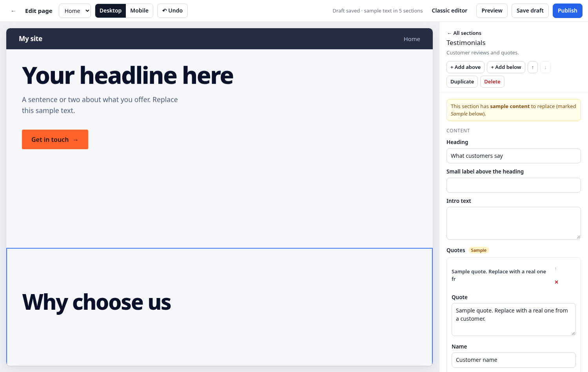

# EmDash Visual Editor

A side-by-side page editor for [EmDash](https://emdashcms.com). Your page is on the left and the settings for the section you're working on are on the right. Click a section on the page to edit it. Most changes show up as you type.

It's built for the people editing your site, who usually aren't developers: no field lists to work through and no guessing what a setting does.



## What it does

- **Click to edit.** Click any section and its settings open. Text updates in the preview as you type.
- **Add, move, duplicate and delete sections.** New sections show up instantly with a placeholder, then the real thing about a second later, with no page reload.
- **Sample content to start from.** Every new section arrives filled with obvious sample text ("Your headline here", "Sample question?") and a neutral placeholder image, so it always shows on the page. Fields still holding sample text are marked **Sample**, and you're asked to confirm before publishing a page that still has any.
- **Unfinished sections never block your work.** If a section is missing something it needs, it's left out of the draft and shows a "fill in X to show this section" note. Everything else keeps saving.
- **Drafts and publishing are EmDash's own.** It saves through EmDash's content API, so revisions, permissions, edit locks and Publish all work as usual.
- **Undo** (Ctrl+Z / Cmd+Z), a desktop or mobile preview, and plain-English error messages with a retry button.

## What's in this repo

This repo is a small, working EmDash site (Astro + Cloudflare Workers + D1). It contains:

| Path | What it is |
|---|---|
| `src/plugins/visual-editor/` | The editor: an EmDash plugin with an admin page (`admin.tsx`), plus the script that runs inside the preview (`frame.ts`) |
| `src/sections/` | Nine core sections: Hero, Rich text, Feature grid, Stats, Testimonials, Gallery, Pricing, FAQ and Call-to-action band. Each folder is one section: its fields (`section.json`), its component, and its CSS |
| `src/sections/placeholders.json` | The sample content new sections start with |
| `src/pages/[...slug].astro` | The page route. It adds the editor's markers only inside the editor preview |
| `scripts/mkseed.py` | Builds `seed/seed.json` (block types, the Pages collection, an example home page) from the section folders |

## Try it

You need Node 22+, pnpm and Python 3.

```sh
git clone https://github.com/DavesAgenda/emdash-visual-editor
cd emdash-visual-editor
pnpm install
pnpm build          # generates the seed, then builds
pnpm preview        # wrangler dev at http://localhost:8787
```

Open http://localhost:8787/_emdash/admin and finish EmDash's first-run setup. Choose **Sample content** to load the example home page, then create a passkey. You're then asked to sign in: use that passkey. Open the editor at http://localhost:8787/_emdash/admin/plugins/visual-editor/.

To deploy, create a D1 database (`npx wrangler d1 create emdash-visual-editor-example`), put its id in `wrangler.jsonc`, then run `pnpm deploy`.

## Adding it to your own EmDash site

1. Copy `src/plugins/visual-editor/` into your site and register it in `astro.config.mjs` (see the `emdash({ plugins: [...] })` block in this repo).
2. Have your page route render blocks inside `<div id="vx-blocks">` and add the frame script when the page is opened by the editor. `src/pages/[...slug].astro` shows how, in about ten lines.
3. Give each section's root element `data-vx-key` (the block's `_key`), and each editable text element `data-vx-f="<key>.<field>"`, only inside the editor preview. `src/sections/_shared/edit.ts` and `Section.astro` do this for you.
4. Optional: add `placeholders.json` entries for your own sections and run `python3 scripts/apply-placeholders.py` to write them into your block types' defaults.

## Adding a section

Make a folder in `src/sections/` with:

- `section.json`: the block type and its fields (EmDash's block type format), plus `optionValues` mapping the labels editors see to the values your component uses
- `MySection.astro`: the component. Wrap it in `<Section value={v} type="my_section">` and spread `{...ed(Astro.locals, v, "field")}` on editable elements
- `index.ts` and `plugin.ts`: copy them from any other section and change the slug

Then run `python3 scripts/mkseed.py`. The section appears in the editor's "Add a section" gallery.

## Known limits

- **Top-level fields only for inline text.** Live typing previews work for a section's own text fields. Items inside lists (FAQ questions, pricing plans) update about a second after you stop typing.
- **Image uploads need R2.** Without an R2 bucket you can pick existing media or paste image links, but you can't upload new images. Add the `MEDIA` binding and build with `R2=1` to turn uploads on.
- **Rich text opens EmDash's classic editor.** Rich text (Portable Text) fields aren't editable in the side panel yet.
- **Section scripts run once.** A section added without a reload doesn't re-run page-load scripts (sliders, counters). Its content shows correctly, and a reload starts the animation.
- **Tested with EmDash 1.1.** EmDash plugins can't replace its built-in screens yet, so the editor lives at its own admin page.

## Licence

MIT. Copyright (c) 2026 Valid Agenda Pty Ltd (Sites by Agents).

Made by [Sites by Agents](https://sitesbyagents.com). Issues and pull requests are welcome. This is maintained alongside client work, so replies may take a while.
